<div align="center">

<!-- Header banner -->


<!-- Typing animation -->
<a href="https://github.com/yuan551">
  
</a>

<br/>


</div>

## 🚀 About Me

```yaml
name: Juan Carlo Dela Cruz
role: Aspiring Full-Stack Developer
school: Quezon City University 🎓
focus: [Machine Learning, Artificial Intelligence, Software Development]
currently: Building full-stack web & mobile applications
mindset: Continuously learning new technologies 🌱
```

- 🎓 Currently studying at **Quezon City University**
- 💻 Building **full-stack web and mobile applications**
- 🤖 Interested in **Machine Learning**, **Artificial Intelligence**, and software development
- 🌱 Continuously learning new technologies and improving my development skills

## 🛠️ Languages and Tools

<div align="center">




</div>

## 📊 GitHub Stats

<div align="center">


</div>

## 🤝 Connect with Me

<div align="center">

<a href="https://www.linkedin.com/in/delacruzjuancarlo/" target="_blank">
  
</a>
<a href="https://www.facebook.com/yuan.callope" target="_blank">
  
</a>
<a href="https://www.instagram.com/_yuaan1/" target="_blank">
  
</a>
<a href="https://github.com/yuan551?tab=repositories" target="_blank">
  
</a>

<br/><br/>

<!-- Footer banner -->


</div>
